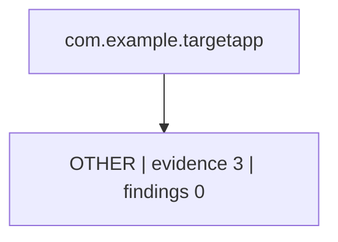

# Attack Surface Mindmap: com.example.targetapp

> Generated by `python scripts/mindmap.py`. Re-run after each milestone.

- **Workspace:** `/home/fire/Depi-project/Depi-project-main/Mobile-Agent/testing/com.example.targetapp`
- **Generated:** 2026-11-11T09:28:25
- **Platform:** unknown
- **Artifact SHA-256:** `not provided`
- **Session:** `not started`
- **Findings:** 0 (none)

## Map

## Ranked surfaces

| MASVS group | Evidence files | Findings | Highest severity | Owner agents |
|---|---|---|---|---|
| OTHER | 3 | 0 | — | compliance-agent, exploitation-agent, frida-script-agent, verification-agent |

## Findings

_No finding JSON files under `findings/` yet._

## Next actions

1. Re-dispatch the owner agent for every group with findings but no verification evidence.
2. Add finding JSON files under `findings/`; re-run this builder to refresh the map.
3. Run `python scripts/orchestrator_runner.py coverage --target <package>` before reporting.
